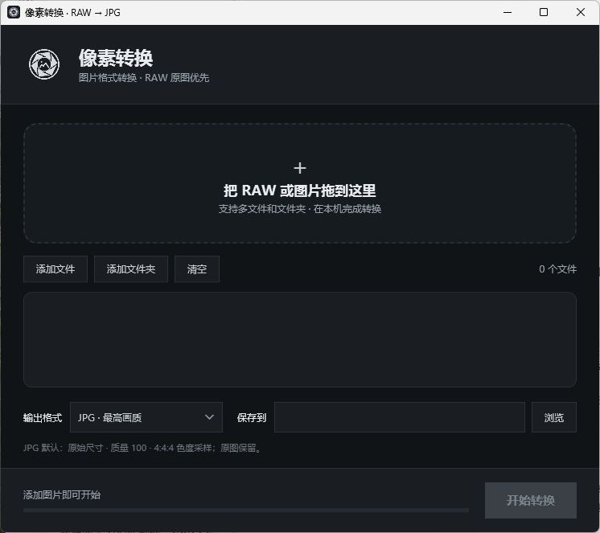

# 像素转换

面向摄影师的 Windows 图片格式转换小工具。支持拖入 RAW 或图片、批量转换为 JPG、PNG、TIFF。

## 下载

从 [Releases](https://github.com/2900141078-max/pixel-converter/releases/latest) 下载 Windows x64 便携包，解压后运行 `RawJpgStudio.exe`。便携包包含 RAW 转换所需的 RawTherapee 引擎。

## 使用

添加文件或文件夹，确认输出文件夹，选择格式后点击「开始转换」。输出文件采用原文件名；重名时添加数字后缀，原文件不会被覆盖。

v1.1 将界面改为光圈银灰配色，新增六叶光圈图标；转换时图标旋转，完成后停止。转换流程和参数保持原样。

RAW 转 JPG 使用 RawTherapee 的完整显影流程和 Auto-Matched Curve 配置，JPG 质量设为 100，色度采样设为 4:4:4。PNG 和 TIFF 输出 16 位。如存在相邻的 `.pp3` 参数文件，也会读取其中的显影参数。原格式与目标格式相同时直接复制文件，避免重新压缩。

## 构建

在 Windows PowerShell 运行 `./build.ps1`。构建脚本使用 Windows .NET Framework 自带的 C# 编译器。要制作完整便携包，请把官方 RawTherapee 5.13 Windows x64 便携版解压到 `vendor/rawtherapee/RawTherapee_5.13_win64_x86_64_release`。

## 已知限制

- 输出格式为 JPG、PNG、TIFF；输入格式以程序文件选择器列出的 RAW、JPG、PNG、TIFF 为准，具体相机型号还取决于转换引擎支持情况。
- JPG 本身为 8 位有损格式。需要继续深度编辑时请选择 16 位 TIFF。
- 首次转换需要几秒初始化引擎。项目随包附带引擎时，整个便携包较大。

## 第三方组件

界面与包装代码为本项目原创。RAW 显影使用 RawTherapee；详见 `THIRD-PARTY-NOTICES.md` 和 `engine/LICENSE`。Filee 仅作为拖放交互参考，未使用其代码或素材。早前讨论的 ConvertTo-Jpeg 脚本未用于此版本。
